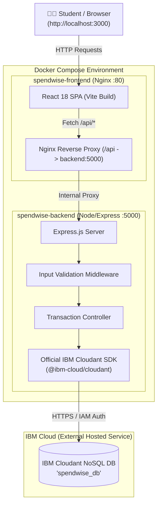

# 💰 SpendWise — Student Expense Tracker

> A full-stack, beginner-friendly college mini project designed to help students track and manage daily expenses, calculate academic semester budgets, and store data securely in the **IBM Cloudant NoSQL** cloud database. Containerized with **Docker & Docker Compose**.

---

## 📋 Table of Contents
1. [Project Overview & Key Features](#-project-overview--key-features)
2. [Technology Stack](#-technology-stack)
3. [System Architecture](#-system-architecture)
4. [IBM Cloudant Setup & Credentials Guide](#-ibm-cloudant-setup--credentials-guide)
5. [Environment Configuration](#-environment-configuration)
6. [Running the Application](#-running-the-application)
   - [Option A: Running with Docker Compose (Recommended)](#option-a-running-with-docker-compose-recommended)
   - [Option B: Running Locally (Development Mode)](#option-b-running-locally-development-mode)
7. [REST API Documentation](#-rest-api-documentation)
8. [Database Schema & Cloudant NoSQL Model](#-database-schema--cloudant-nosql-model)
9. [Troubleshooting & Testing](#-troubleshooting--testing)
10. [College Project Viva & Demonstration Guide](#-college-project-viva--demonstration-guide)

---

## 🌟 Project Overview & Key Features

**SpendWise** is built specifically for college students who need an intuitive, fast, and organized way to manage pocket money, hostel bills, food expenses, course books, tuition fees, and project costs.

### Core Features:
- 📊 **Real-time Dashboard**: Displays total expenses, today's expenses, current monthly expenses, and total transaction count, dynamically aggregated from actual database records.
- ➕ **Expense Logging**: Add expenses with a title, amount in INR (₹), category, date, and optional description/notes.
- 📋 **Clean Records Table**: Responsive data table with colored category badges, formatted Indian Rupee (₹) currency values, and formatted dates.
- ✏️ **Full Editing Support**: Edit any existing expense record in a pre-populated modal dialog.
- 🗑️ **Safe Deletion with Confirmation**: Delete expenses with an alert modal dialog that displays the document ID and details before permanent deletion.
- 🔍 **Live Search & Filter**: Instant search by expense title or description, along with category filtering (Food, Books, Transport, Tuition, etc.) and date/amount sorting.
- ☁️ **IBM Cloudant NoSQL Engine**: Powered by the official IBM Cloudant Node.js SDK (`@ibm-cloud/cloudant`), handling document IDs (`_id`) and revision hashes (`_rev`) with MVCC concurrency.
- 🚦 **Status & Feedback Indicators**: Visual database connectivity status dot, loading spinners, input validation error messages, and animated notification toasts.
- 🐳 **Dockerized Microservices**: Pre-configured `Dockerfile` for frontend and backend with `docker-compose.yml` for single-command deployment.

---

## 🛠️ Technology Stack

| Layer | Technology | Purpose |
| :--- | :--- | :--- |
| **Frontend** | React 18, Vite | Component-based, lightning-fast reactive User Interface |
| **Icons** | Lucide React | Modern, crisp UI icons for categories and actions |
| **Styling** | Plain Vanilla CSS | Modern midnight dark mode, glassmorphism, responsive grid |
| **Backend** | Node.js (v20+ / v22), Express.js | RESTful API server, routing, input validation middleware |
| **Database** | IBM Cloudant (Apache CouchDB) | Managed NoSQL JSON document database hosted on IBM Cloud |
| **SDK** | `@ibm-cloud/cloudant` & `ibm-cloud-sdk-core` | Official enterprise SDK for Cloudant document CRUD |
| **Reverse Proxy** | Nginx Alpine (Docker) | Production static SPA serving and internal `/api` proxying |
| **Containerization**| Docker & Docker Compose | Multi-container isolation, reproducible local deployment |

---

## 🏗️ System Architecture



---

## ☁️ IBM Cloudant Setup & Credentials Guide

SpendWise uses a **real IBM Cloudant NoSQL database** hosted on IBM Cloud. The database `spendwise_db` is **automatically created by the backend on first run** if it doesn't already exist.

Follow these simple steps to get your free Cloudant credentials:

### Step 1: Sign Up / Log In to IBM Cloud
1. Go to [https://cloud.ibm.com/registration](https://cloud.ibm.com/registration) and sign up for a free IBM Cloud account (or log in).

### Step 2: Create a Cloudant Service Instance
1. In the top search bar or catalog, search for **Cloudant**.
2. Select the **Cloudant** tile.
3. Configuration choices:
   - **Authentication method**: Choose **IAM and legacy credentials** (or **IAM only**).
   - **Plan**: Select **Lite** (Free tier: 1 GB storage, 20 reads/sec, 10 writes/sec, 5 queries/sec — perfect for student projects).
4. Click **Create** at the bottom right.

### Step 3: Generate Service Credentials
1. After the service is created, go to the **Service credentials** tab in the left sidebar.
2. Click the blue **New credential** button.
3. Keep the default name (e.g., `spendwise-cred`) and click **Add**.
4. Click the small downward arrow next to the new credential to view details.
5. Copy the following two fields:
   - `url`: (e.g., `https://xxxxxxxx-bluemix.cloudantnosqldb.appdomain.cloud`)
   - `apikey`: (e.g., `aBcDeFgHiJkLmNoPqRsTuVwXyZ1234567890`)

---

## ⚙️ Environment Configuration

Create a `.env` file in the project root (or inside `backend/.env`) by copying the template:

```bash
cp .env.example .env
```

Open `.env` in your code editor and fill in your copied IBM Cloudant credentials:

```ini
# SpendWise Backend Environment Variables
PORT=5000
NODE_ENV=development

# IBM Cloudant Credentials
CLOUDANT_URL=https://your-instance-id-bluemix.cloudantnosqldb.appdomain.cloud
CLOUDANT_APIKEY=your_copied_iam_apikey_here
CLOUDANT_DB_NAME=spendwise_db

# Frontend Dev Proxy
VITE_BACKEND_URL=http://localhost:5000
```

> ⚠️ **Important Security Note**: The `.env` file contains secret API keys. It is automatically ignored in `.gitignore` and `.dockerignore`. Never commit your `.env` file to GitHub.

---

## 🚀 Running the Application

### Option A: Running with Docker Compose (Recommended)

Docker Compose builds both the frontend and backend microservices into isolated containers and establishes an internal bridge network.

1. Ensure Docker Desktop is running on your computer.
2. Ensure your `.env` file is saved with your `CLOUDANT_URL` and `CLOUDANT_APIKEY`.
3. Open a terminal in the project root directory and run:

```bash
docker compose up --build
```

4. Once the containers are running:
   - **Frontend Application**: Open [http://localhost:3000](http://localhost:3000)
   - **Backend API**: Open [http://localhost:5000/api/health](http://localhost:5000/api/health)

To stop the containers:
```bash
docker compose down
```

---

### Option B: Running Locally (Development Mode)

If you wish to run the app directly using Node.js without Docker:

#### 1. Start the Backend Server:
```bash
cd backend
npm install
# Ensure backend/.env exists with your Cloudant credentials
npm run dev
```
*Backend will start listening on [http://localhost:5000](http://localhost:5000).*

#### 2. Start the Frontend Dev Server:
In a new terminal window:
```bash
cd frontend
npm install
npm run dev
```
*Frontend will start on [http://localhost:3000](http://localhost:3000).*

---

## 📡 REST API Documentation

All endpoints return structured JSON. The base URL is `/api`.

### 1. Health Check
- **Endpoint**: `GET /api/health`
- **Description**: Returns server status and IBM Cloudant database connectivity.
- **Sample Response**:
  ```json
  {
    "success": true,
    "status": "healthy",
    "service": "SpendWise Student Expense Tracker API",
    "timestamp": "2026-10-15T12:00:00.000Z",
    "database": {
      "configured": true,
      "connected": true,
      "dbName": "spendwise_db",
      "docCount": 8,
      "message": "Connected to IBM Cloudant NoSQL database"
    }
  }
  ```

---

### 2. Get All Expenses (with Metrics)
- **Endpoint**: `GET /api/transactions`
- **Query Parameters**:
  - `search` *(optional)*: Search term matching title or description (e.g. `?search=book`)
  - `category` *(optional)*: Category name (e.g. `?category=Food%20%26%20Dining`)
- **Sample Response**:
  ```json
  {
    "success": true,
    "count": 2,
    "totalCount": 2,
    "summary": {
      "totalExpenses": 1450.00,
      "todayExpenses": 250.00,
      "monthlyExpenses": 1450.00,
      "transactionCount": 2
    },
    "data": [
      {
        "_id": "6a9e1f827c89b2e",
        "_rev": "1-4b8c9d0e1f2a3b4",
        "type": "expense",
        "title": "Data Structures & Algorithms Textbook",
        "amount": 1200.00,
        "category": "Books & Supplies",
        "date": "2026-10-14",
        "description": "Purchased from college campus bookstore",
        "createdAt": "2026-10-14T10:30:00.000Z",
        "updatedAt": "2026-10-14T10:30:00.000Z"
      }
    ]
  }
  ```

---

### 3. Get Expense by ID
- **Endpoint**: `GET /api/transactions/:id`
- **Description**: Retrieves a single document by its Cloudant document ID.

---

### 4. Create New Expense
- **Endpoint**: `POST /api/transactions`
- **Headers**: `Content-Type: application/json`
- **Request Body**:
  ```json
  {
    "title": "Semester Metro Pass",
    "amount": 800,
    "category": "Transport",
    "date": "2026-10-15",
    "description": "Monthly student concession card recharge"
  }
  ```
- **Response Status**: `201 Created`
- **Sample Response**:
  ```json
  {
    "success": true,
    "message": "Expense recorded successfully in IBM Cloudant",
    "data": {
      "_id": "9d8e7f6a5b4c3d2e",
      "_rev": "1-0a1b2c3d4e5f6g7",
      "type": "expense",
      "title": "Semester Metro Pass",
      "amount": 800,
      "category": "Transport",
      "date": "2026-10-15",
      "description": "Monthly student concession card recharge",
      "createdAt": "2026-10-15T11:00:00.000Z",
      "updatedAt": "2026-10-15T11:00:00.000Z"
    }
  }
  ```

---

### 5. Update Expense
- **Endpoint**: `PUT /api/transactions/:id`
- **Headers**: `Content-Type: application/json`
- **Request Body**:
  ```json
  {
    "title": "Semester Metro Pass (Updated)",
    "amount": 850,
    "category": "Transport",
    "date": "2026-10-15",
    "description": "Updated fare with return journey included",
    "_rev": "1-0a1b2c3d4e5f6g7"
  }
  ```
- **Response Status**: `200 OK`
- **Note**: Handled with CouchDB/Cloudant MVCC revision numbers to prevent concurrency conflicts.

---

### 6. Delete Expense
- **Endpoint**: `DELETE /api/transactions/:id`
- **Optional Query**: `?rev=<_rev>`
- **Response Status**: `200 OK`
- **Sample Response**:
  ```json
  {
    "success": true,
    "message": "Expense deleted successfully from IBM Cloudant",
    "data": {
      "id": "9d8e7f6a5b4c3d2e",
      "rev": "2-3c4d5e6f7g8h9i0"
    }
  }
  ```

---

## 🗄️ Database Schema & Cloudant NoSQL Model

IBM Cloudant is a schema-less NoSQL document store based on Apache CouchDB. In SpendWise, each expense is stored as a JSON document:

```json
{
  "_id": "3f9c8d7b6a5e4d3c2b1a0",
  "_rev": "2-e8b7a6c5d4f3e2d1c0b",
  "type": "expense",
  "title": "Hostel WiFi Contribution",
  "amount": 450.00,
  "category": "Utilities",
  "date": "2026-10-15",
  "description": "Shared broadband fee with room 304",
  "createdAt": "2026-10-15T08:15:30.000Z",
  "updatedAt": "2026-10-15T09:20:00.000Z"
}
```

### Why `_id` and `_rev` matter:
- `_id`: The immutable primary key that uniquely identifies the document.
- `_rev`: The revision token. Whenever a document is modified or deleted, Cloudant requires the current `_rev` to implement **Multi-Version Concurrency Control (MVCC)**, preventing accidental data overwrites.

---

## 🔍 Troubleshooting & Testing

| Issue | Cause | Solution |
| :--- | :--- | :--- |
| **Status says "Cloudant Offline"** | Missing credentials in `.env` | Ensure `CLOUDANT_URL` and `CLOUDANT_APIKEY` are set in `.env` and restart the backend. |
| **HTTP 401 Unauthorized** | Invalid IAM API Key | Verify the API key in the IBM Cloud Console under Service Credentials. |
| **HTTP 409 Conflict** | Cloudant `_rev` mismatch | The document was edited concurrently. Refresh the page to fetch the latest `_rev` and re-save. |
| **Port 5000 or 3000 in use** | Another process is occupying the port | Change `PORT` in `.env` or terminate the occupying process. |
| **Docker Compose network error** | Docker engine not running | Launch Docker Desktop and re-run `docker compose up --build`. |

### Automated Build Verification:
- **Backend check**: `cd backend && node src/server.js`
- **Frontend check**: `cd frontend && npm run build`

---

## 🎓 College Project Viva & Demonstration Guide

Check out [`VIVA.md`](./VIVA.md) for:
- 📌 20+ Frequently Asked Viva Questions with plain English answers (React, Express, REST APIs, Cloudant NoSQL, MVCC, Docker).
- ⏱️ A complete **3-Minute Demonstration Script** structured specifically for examiners and professors.
